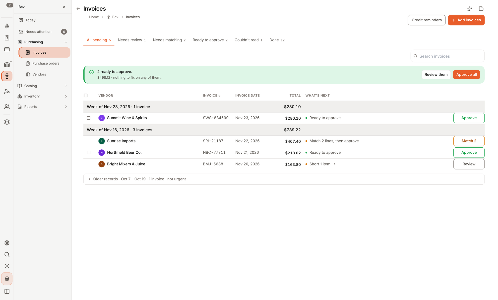
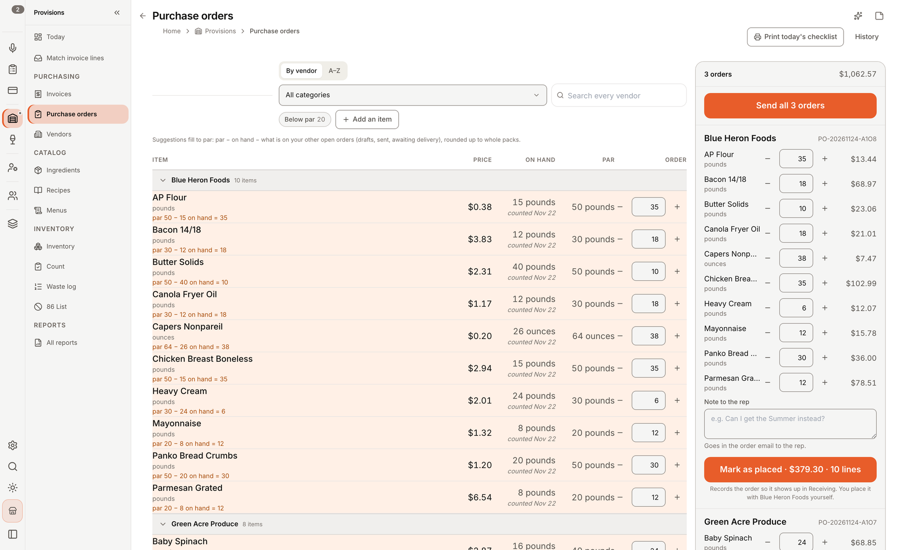
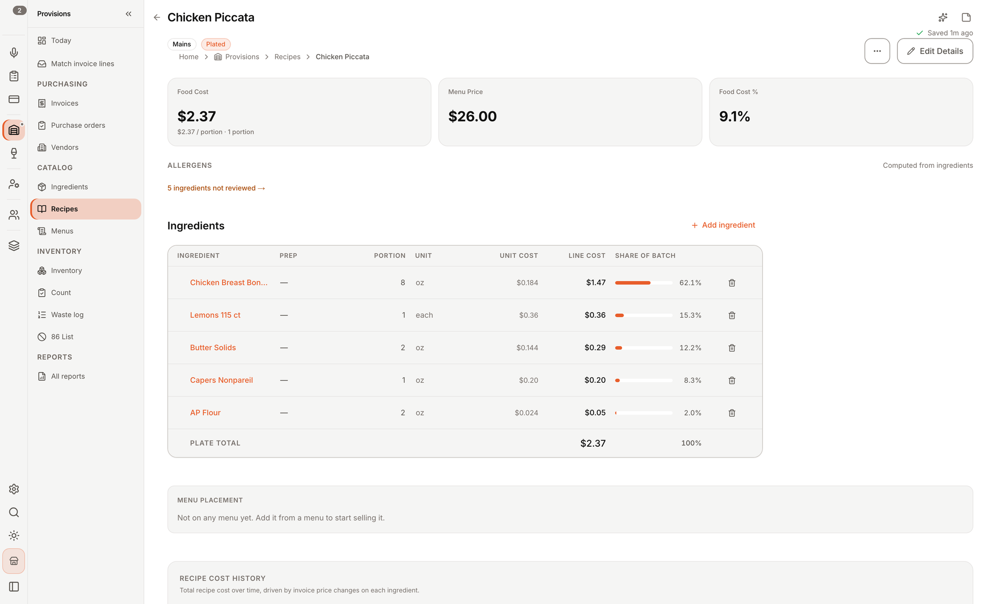
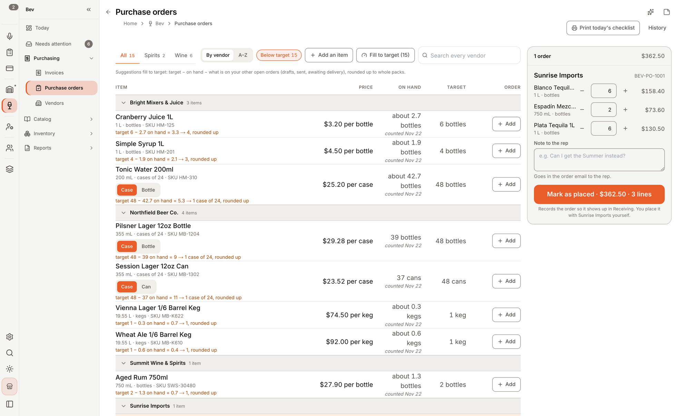

# Restaurant Ops

**Restaurant operations software running at a working restaurant in Maine: read the invoices, place the orders, and know what every plate and pour costs.**

Demo on request · Built in Maine with a working restaurant · Code is private, this repo is the walkthrough

## The problem

Independent restaurants buy from a dozen vendors, and every vendor invoices differently. One bills by the case, one by the bottle, one by the pound. Deposits, returns and short deliveries are mixed in with the food and drink. The paper ends up in a pile.

So the numbers that matter arrive late or not at all. The chef does not know butter went up until the month closes. The bar orders from memory. A recipe costed last year is still priced off last year's invoice.

## Who it's for

Owners, managers, chefs and bar managers at independent restaurants. I build it alongside a working restaurant in Maine, and the screens follow the questions people there ask:

- **What came in, and is this invoice right?**
- **What do I need to order, from whom, and how much?**
- **What does this plate or pour cost me today?**
- **Which prices moved, and which menu items did that hit?**

## What it does

| Screen | What it answers |
|---|---|
| **Invoices** | Snap a photo, upload a PDF or forward an email. Lines are read, matched to your items and checked against the printed total. Clean ones wait in one place to approve. The rest say exactly what is wrong: match two lines, one item short, could not be read. |
| **Ordering** | Every vendor's items in one list, with what is on hand, your par and the suggested quantity with the arithmetic shown. Build several vendors' orders at once. They go out by email to each vendor with a rep on file, or get marked as placed when you order another way. |
| **Recipes and costing** | Plate cost, menu price and food cost percent, built from ingredient prices on approved invoices. See which ingredient drives the cost and which dishes are over target. |
| **Beverage ordering** | The same order builder, shaped for a bar: bottles, cases and kegs, targets per item and whole-case rounding. Beverage data stays separate from the kitchen. |

*Screenshots use demo data. Vendors, prices, people and invoice numbers are made up.*

Around those four sit counts, waste, vendors, menus and cost reports. The same codebase also has reservations and floor plan, staff scheduling, and a phone assistant, at different stages.

## How it works

- **AI reads, people approve.** A vision model reads the invoice into lines. A smaller model takes the routine ones, and unfamiliar vendors or doubtful reads go to a stronger one. A person approves it, or a strict set of checks can if the restaurant turns that on.
- **Plain code checks the math.** Line totals, fees, tax and deposits have to agree with the printed total before an invoice can be approved. The software never rewrites what the paper says.
- **It learns each vendor, carefully.** A confirmed match is remembered for that vendor's wording, item code and pack size. A close guess stays a suggestion until someone accepts it.
- **Approved prices flow through.** Approving an invoice updates the ingredient price, its price history, stock and the cost of the recipes that use it.
- **Kitchen and bar share one system, not one list.** The two sides use the same tables and screens, and every request is scoped to food, supplies or beverage.
- **Mistakes can be undone.** Changes are logged, and most can be reversed from the screen. The exceptions are named on purpose.
- **Built by an agent pipeline.** I write the spec and rulings, AI agents build in isolated worktrees with their own throwaway databases, and CI plus more than 100 custom code checks guard the merge. Agents never hold production credentials. Migrations and deploys are run by hand.

## Stack

TypeScript, Next.js 16, React 19, Supabase (Postgres, Auth, Storage), Claude for invoice reading, Tailwind, Radix UI, Recharts, Zod, Postmark, Twilio, Stripe, Square, Vitest, Playwright, Sentry, Vercel. Built with Claude Code.

## What I learned

- **Reading the invoice is the easy half.** Knowing that "12/750" at $96 is a case of wine and not one bottle is the hard half. Pack size mistakes turn into wrong stock, wrong orders and wrong costs.
- **A guess must look like a guess.** An early version showed a strong suggestion as matched on one screen while another held it for review. Now every screen reads the same stored answer.
- **Do not fix the paper.** The software once smoothed small gaps between the lines and the printed total. It broke correct invoices that carried a small deposit. Now a gap is a question for a person.
- **Nobody wants a dashboard at 4pm.** The home screen turned into a short list of what is waiting on you, with a button on each row. Cards that did not lead to an action were removed.
- **Blank is better than wrong.** An unknown cost shown as zero looks like great news. Missing prices now read as missing, and suspicious ones are held out of the averages.

## Status

In use on the beverage side at a working restaurant in Maine, where bar invoices and orders run through it. The kitchen side is built on the same engine and is being tested in demo restaurants before it goes live there. Access is by invitation, with roles that control who sees prices, approves invoices and places orders.

---

Built by [John Ross](https://github.com/JR-BEI) · [X @TheFinalRoss](https://x.com/TheFinalRoss) · [LinkedIn](https://www.linkedin.com/in/johnrossbuilds)
